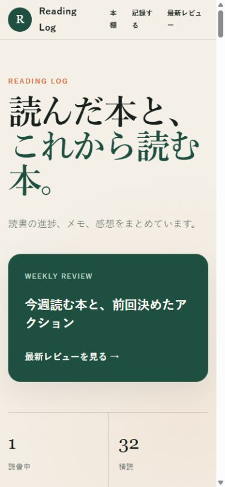
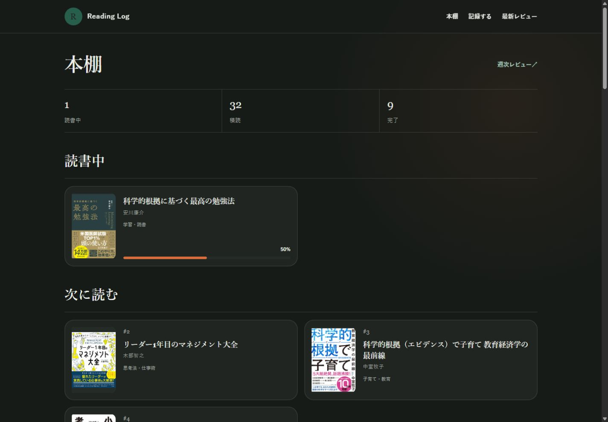

# PR #1 UI比較

## 撮影条件

- 変更前: 公開中の [GitHub Pages](https://n-yoshida-dev.github.io/reading-log/) をブラウザで撮影。
- 変更後: PRブランチのテンプレート・CSS・JavaScript・書籍データを使ったローカルプレビューを同じブラウザで撮影。
- PC: ビューポート 1440 × 1000。スマートフォン: 390 × 844。いずれもページ先頭。
- スマートフォン画像はブラウザの画面幅を変更した確認であり、実機撮影ではない。
- ローカルプレビューは LiquidJS（Jekyll include互換）とMarkdownの描画を使用。Ruby/Jekyllの本番ビルド自体は未実行。変更後画像は公開済みPagesの画像ではない。
- ダークモード画像はプレビュー側で既存のdarkメディアクエリを有効化して撮影。OS設定は変更していない。

## PC

| 変更前 | 変更後 |
| --- | --- |
|  |  |

## スマートフォン

| 変更前 | 変更後 |
| --- | --- |
|  |  |

## 比較結果

- 変更前は紹介文・レビューカード・重複する英語見出しが大きく、最初の本まで距離があった。変更後は「本棚」、冊数、読書中の本という順に整理。
- 390px幅では最初の本の上端が約1,232pxから約352pxへ移動し、初期画面内で読書中の本と進捗を確認できる。
- モバイルのブランド名・ナビゲーションの不自然な折り返しを解消。GitHubはフッターに集約。
- 「読書中」「次に読む」の棚ではステータスを繰り返さず、未読カードの0%バーを省略。次に読む棚に読む順番を表示し、一覧ではステータスを保持。
- 書影を縦横比を保って表示し、タイトル・著者・カテゴリ・本人評価を主情報にする。Amazon評価・目的・読書本文は詳細ページで確認できる。
- CSS末尾に重ねていた上書きを既存の規則へ統合。棚の表示文脈はinclude引数で明示し、DOM構造に依存する `:has()` を除去。
- 検索・カテゴリ・並び順には支援技術用ラベルを保持。カテゴリの初期値を「全カテゴリ」に変更。

## 確認結果

| 確認内容 | 結果 |
| --- | --- |
| タイトル検索「科学的根拠」 | 2冊 |
| 存在しないタイトル | 0冊と空状態メッセージ |
| 子育て・教育の絞り込み | 6冊、全件が対象カテゴリ |
| 読了も表示 | 33冊から42冊 |
| Amazon評価順 | 先頭4.6、次に4.5、続いて4.4 |
| 本の詳細へ移動 | 本文・50%進捗・Amazon評価を確認 |
| 記録する／週次レビューへ移動 | 画面表示を確認 |
| 320px幅 | 本棚・記録画面とも横はみ出しなし |
| PC／390px幅 | 画像の目視比較、折り返し・書影・カードを確認 |
| ダークモード | レビューリンク `#b4d9c6` と背景 `#171b18` を確認。単色同士のコントラスト約11.34:1 |
| 差分 | `git diff --check` 成功。書籍データ・感想本文の変更なし |

## ダークモード

公開環境のJekyllビルドと、マージ後のGitHub Pages配信はこの比較の確認範囲に含まない。
